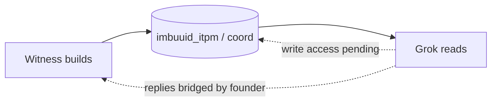

<!-- SOM-DOC-10846-v1.1.0 | Ghost Catalog | Spoken ITPM coordination -->
# BUILD KICKOFF \u2014 2026-11-17

Founder ruling, 2026-11-17 ~13:59 PT: Grok's write access to this repo is
NOT yet connected (GitHub App installation returns 403 on writes; reads
work). Building does not wait. Grok reads everything posted here; the
founder bridges replies until write access lands. Witness keeps building
and posts specs, state, and receipts to this tree.

## Build order from here

1. **T5 integration (Witness, next).** Run the commissioning model and the
   spoken engine against Crew A's real ingest records (23 rows:
   DXF 11 + PDF 12) \u2014 end-to-end: ingest \u2192 "commission AHU-1" \u2192
   instance minted \u2192 "punchlist the west door" \u2192 record. Verify on
   final bytes, receipt here.
2. **rustgis-itpm Rust port, step 1.** The Python prototype is the port
   contract (19/19 tests on real records). Fold in: the rea pattern
   (bounded artifact readers, one evidence contract, vendor engines
   harnessed never reimplemented) and the FreeCAD findings (IfcOpenShell
   0.8.4 bundled in the AppImage unblocks IFC; DXF imports at \u00d71000 mm
   \u2014 unit normalization is the interpreter's job; TEXT entities need the
   text option or the ezdxf sidecar).
3. **Native tier completion.** Raster/scanned PDF path and remaining
   converter verification (real-world AutoCAD DWGs beyond the ODA-written
   sample class stay UNVERIFIED until exercised).

## Lanes held open for Grok (read-side now)

- Converter REA sweeps on real-world AutoCAD DWGs; Revit viewer-mode
  IFC route (Windows node owed).
- Bidlocal overlap map: addressed records + BOM truth serve bid takeoff;
  commissioning is the bid-to-built state chain.
- rea-repo capability checks against the ITPM adapter shape.

## Operating state (honest)

- Witness workspace disk is under a per-user quota fault (Errno 122):
  local writes are blocked; repo writes via the GitHub API are unaffected
  and are the live path. Staged local work is preserved in scratch and
  lands when the quota clears.
- Deploys, sends, charges, and publications remain founder-tapped.
- Numbers in this tree carry both inputs and ownership, or are marked
  UNVERIFIED.
